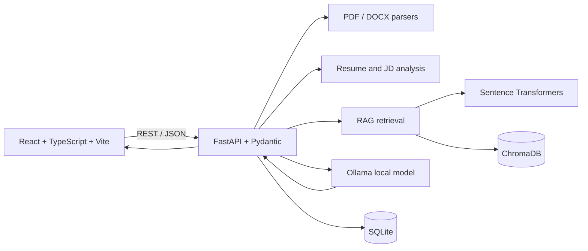

# LLM Interview Copilot

A local-first interview practice workspace. Add resume text and a job description, create a tailored mock interview, answer one question at a time, and review transparent practice feedback. The project is designed for learning and portfolio discussion; its scores are not an assessment of hiring probability or real interview performance.

## What it does

- Parses PDF/DOCX resumes locally and runs explainable keyword/section analysis.
- Compares resume and job-description skill keywords. Match percentages are heuristic overlap estimates, not hiring probabilities.
- Uses configurable Ollama for question generation and structured answer evaluation, with an opt-in deterministic mock mode for tests.
- Automatically chunks, embeds, and indexes uploaded/pasted resumes and analyzed job descriptions with Sentence Transformers and ChromaDB, then retrieves workspace-scoped evidence for questions and feedback. Identical content is not re-embedded.
- Persists interview questions, submitted answers, and feedback in SQLite.
- Provides a responsive React dashboard, skill chart, session history, report viewer, JSON/PDF export, and light/dark themes.
- Original resume files are parsed in memory and not written to disk. Extracted document chunks and interview answers are persisted locally in ChromaDB and SQLite.

## Architecture



### AI pipeline, interview explanation

1. **LLM:** Ollama runs the instruction-following model on the local machine. It proposes questions and evaluates an answer against criteria. The API validates the returned JSON with Pydantic; malformed output is surfaced as a retryable service error.
2. **Embeddings:** Sentence Transformers maps each document chunk to a numeric vector that represents semantic meaning.
3. **Vector database:** ChromaDB persists those vectors and source metadata locally.
4. **RAG:** Resume and job-description text is automatically chunked and embedded when analyzed/uploaded; content hashes avoid duplicate indexing. A question is embedded, related chunks from the same local workspace are retrieved, and those snippets are passed to the LLM as context. This is retrieval-augmented generation, not model fine-tuning.
5. **Evaluation:** The model returns a score, category scores, strengths, missing concepts, unsupported statements, a sample improved answer, and a follow-up question. Scores are practice feedback only; they can be imperfect.
6. **Analysis:** Resume/JD skill overlap is a transparent keyword heuristic, not an LLM judgment or objective probability.

## Requirements

- Windows 10/11, PowerShell
- Python 3.12+
- Node.js 20+ and npm
- Ollama for live local question generation and answer evaluation (optional deterministic mock mode is available for tests)
- Internet access is needed initially to install packages, download the Ollama model, and fetch the embedding model. Document inference and persistence then run locally. No paid API or cloud LLM is used.

## Windows setup (PowerShell)

Run these commands from the repository root (`llm-interview-copilot`):

```powershell
py -3.12 -m venv .venv
.\.venv\Scripts\Activate.ps1
python -m pip install --upgrade pip
python -m pip install -r backend\requirements.txt
Copy-Item .env.example .env
```

If PowerShell blocks venv activation, use this for the current terminal only:

```powershell
Set-ExecutionPolicy -Scope Process -ExecutionPolicy Bypass
.\.venv\Scripts\Activate.ps1
```

Install Ollama, then download the configured model:

```powershell
winget install --id Ollama.Ollama -e
ollama pull llama3.2
ollama list
```

To choose a different compatible instruction model, set `OLLAMA_MODEL` in `.env`, then pull that same model. Verify the service and configured model at `http://localhost:8000/api/llm/status` after starting the API. If Ollama setup did not start its local server automatically, open another terminal and run `ollama serve`. The first RAG index operation downloads `sentence-transformers/all-MiniLM-L6-v2` into the local model cache.

For automated/local UI work without an installed model, set `MOCK_LLM=true` in `.env` before starting the backend. The mock returns clearly marked deterministic practice fixtures; it does **not** test or replace real model inference. Set it back to `false` for Ollama.

Start the backend from the repository root:

```powershell
$env:PYTHONPATH = "$PWD\backend"
python -m uvicorn app.main:app --app-dir backend --reload
```

Start the frontend in a second terminal:

```powershell
Set-Location .\frontend
npm install
npm run dev
```

Open [http://localhost:5173](http://localhost:5173). Swagger API docs are at [http://localhost:8000/docs](http://localhost:8000/docs); health check: [http://localhost:8000/api/health](http://localhost:8000/api/health).

## Configuration

Copy `.env.example` to `.env`. Available settings:

| Variable | Default | Purpose |
|---|---|---|
| `DATABASE_URL` | `sqlite:///./interview_copilot.db` | SQLAlchemy persistence |
| `OLLAMA_BASE_URL` | `http://localhost:11434` | Ollama endpoint |
| `OLLAMA_MODEL` | `llama3.2` | Installed model used for generation and evaluation |
| `OLLAMA_TIMEOUT_SECONDS` | `180` | Per-request timeout (1-600 seconds) |
| `MOCK_LLM` | `false` | Enable deterministic fixtures for local testing only |
| `DEBUG` | `false` | Enable development diagnostics; raw output is logged only for requests explicitly marked as free of user-provided content |
| `EMBEDDING_MODEL` | `sentence-transformers/all-MiniLM-L6-v2` | Local embedding model |
| `CHROMA_PATH` | `./chroma_data` | Local vector-store directory |
| `MAX_UPLOAD_SIZE_MB` | `10` | Maximum accepted resume size |
| `CORS_ORIGINS` | `http://localhost:5173,http://127.0.0.1:5173` | Allowed frontend origins |

Change a value in `.env` before startup if your Ollama model or port differs.

## API overview

| Method | Endpoint | Purpose |
|---|---|---|
| `GET` | `/api/health` | Service status |
| `POST` | `/api/resume/upload` | Parse PDF/DOCX and return resume analysis |
| `POST` | `/api/resume/analyze` | Analyze pasted resume text |
| `POST` | `/api/job/analyze` | Compare JD skill terms with optional resume text |
| `GET` | `/api/llm/status` | Check Ollama connectivity and configured model availability |
| `POST` | `/api/rag/index` | Idempotently chunk, embed, and index text for a workspace |
| `POST` | `/api/rag/search` | Retrieve relevant chunks from the specified workspace |
| `POST` | `/api/interviews/generate` | Generate questions without creating a session |
| `POST` | `/api/interviews/start` | Generate and persist a mock-interview session |
| `POST` | `/api/interviews/{session_id}/answer` | Evaluate the current answer and advance |
| `POST` | `/api/interviews/{session_id}/next-question` | Return the current unanswered question |
| `POST` | `/api/interviews/{session_id}/finish` | Finish and return a report |
| `GET` | `/api/interviews/history` | List recent sessions |
| `GET` | `/api/interviews/{session_id}/report` | Read a session report |
| `GET` | `/api/interviews/{session_id}/export?format=json` | Download report JSON |
| `GET` | `/api/interviews/{session_id}/export?format=pdf` | Download a completed-interview PDF |
| `DELETE` | `/api/interviews/{session_id}` | Delete a session |
| `GET` | `/api/dashboard/stats` | Dashboard and topic statistics |

Interactive request/response schemas and Try-it-out are available in Swagger. The generated mock interview screen does not reveal evaluation criteria or expected concepts before submitting an answer.

## Demo inputs

Paste [`data/sample/sample_resume.txt`](./data/sample/sample_resume.txt) and [`data/sample/sample_job_description.txt`](./data/sample/sample_job_description.txt) into the preparation page. They are fictional examples for trying the keyword analysis and interview setup.

## Testing

From the repository root:

```powershell
$env:PYTHONPATH = "$PWD\backend"
python -m pytest backend\tests -q
Set-Location .\frontend
npm run build
```

Backend workflow tests use `MOCK_LLM` fixtures/LLM mocks and do not require Ollama. Structured Ollama responses use the Pydantic JSON Schema through Ollama's `format` parameter, with strict JSON extraction and up to three attempts for malformed or schema-invalid output. Raw response diagnostics are off by default and are omitted for prompts containing user-provided content. RAG unit tests mock the embedder; a separate local smoke check was run with the actual Sentence Transformers model and ChromaDB. First use may download the embedding model. An installed Ollama model is required for live generation.

## Optional Docker Compose

Docker Desktop with its Linux container engine running is required. Ollama is optional; the default Compose backend connects to Ollama installed on Windows via `host.docker.internal`. From the repository root:

```powershell
Copy-Item .env.example .env
docker compose up --build -d
```

To run Ollama inside Compose instead, use its optional profile and point the backend to the service:

```powershell
$env:DOCKER_OLLAMA_BASE_URL = "http://ollama:11434"
docker compose --profile ollama up --build -d
docker compose exec ollama ollama pull llama3.2
```

The UI, Swagger, and host Ollama URLs are `http://localhost:5173`, `http://localhost:8000/docs`, and `http://localhost:11434`. Compose health checks gate frontend startup on a healthy backend. Stop services with `docker compose down`; application and optional Ollama data remain in named volumes.

Compose syntax validation passed with `docker compose config --quiet`. Image builds were attempted but could not run because Docker Desktop's Linux engine/daemon was not running.

## Screenshots

_Screenshots will be added after capturing the application running locally._

## Limitations and future improvements

- **Verified feature status (2026-10-29):** mock interview question/evaluation API workflow and PDF report generation are covered by backend tests; workspace-scoped RAG was also manually smoke-tested with the actual local embedding model and ChromaDB. Live question generation, answer evaluation, and PDF export have been exercised with Ollama `llama3.2` on Ollama 0.40.13. Frontend TypeScript/production build and Compose config validation pass.
- **Not verified:** live Ollama inference. Ollama is not installed/on PATH on the development machine. Docker image builds also remain unverified because the Docker daemon was unavailable.
- The resume/JD analysis is keyword-based and should be manually verified. It cannot infer or validate a person's qualifications.
- LLM feedback varies by model and prompt. Scores are practice feedback only and must not be used for hiring decisions.
- Local model quality, latency, memory usage, and language support depend on hardware and the selected model.
- The app uses a local browser workspace identifier, not authentication. It is intended for one local user; do not expose these services to an untrusted network without adding real authentication and authorization.
- Useful next steps: richer resume section extraction, document deletion controls, and accessibility/browser tests.

## Repository layout

```text
backend/app/        FastAPI routes, schemas, SQLite models and AI/document services
backend/tests/      Unit and API workflow tests
frontend/src/       React screens, API client, types and styling
data/sample/        Fictional demo resume and job description
docs/               Windows setup notes
```
